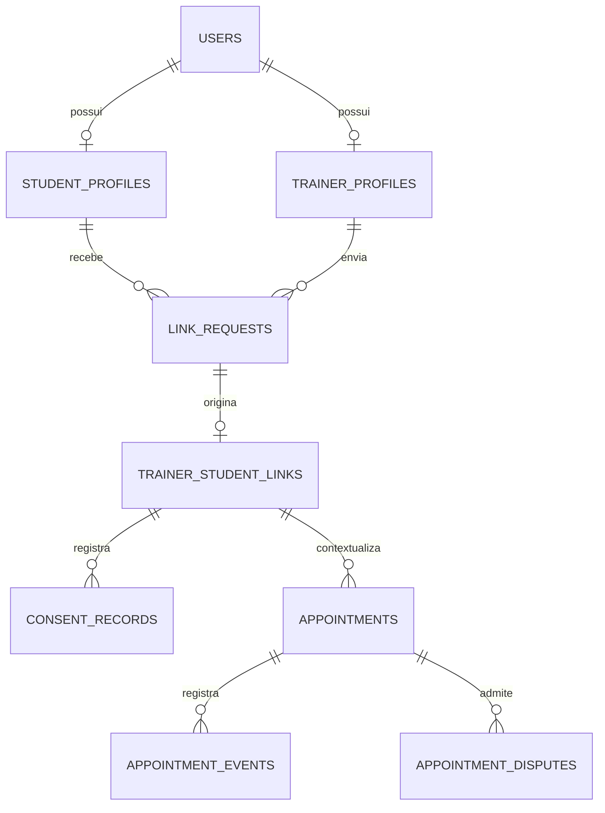
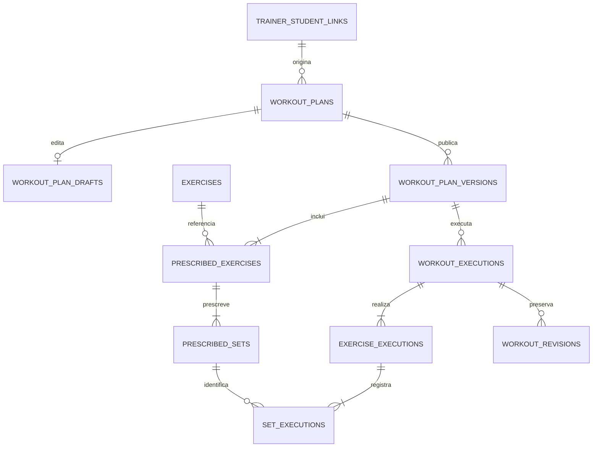

# Arquitetura técnica e modelo físico

## Fronteiras e dependências

O React entrega um cliente de desenvolvimento responsivo. O SDK do Supabase obtém a sessão. O cliente envia o access token à API NestJS e só envia a chave pública de cliente ao provedor de identidade. A API valida o JWT e resolve o UUID do domínio pelo subject do provedor. O papel vem da tabela users. O Prisma usa o adaptador pg e uma credencial própria de runtime. O schema personalhub fica fora das exposições diretas ao navegador.

O monólito modular coloca o tratamento da agenda e do consentimento sob a mesma transação do vínculo. Prisma e SQL nativo compartilham a conexão transacional. O repositório mantém contratos TypeScript e o contrato OpenAPI. O frontend final poderá consumir a mesma API.

| Local | Responsabilidade | Depende de |
|---|---|---|
| apps/web | Autenticação, cadastro e formulários técnicos de vínculo, treino, peso e agenda | SDK Supabase e REST. O código entregue ao navegador contém apenas configuração pública |
| packages/contracts | Papéis, campos, aviso de compartilhamento e esquemas Zod | Nenhum acesso a rede ou banco |
| apps/api/src/auth.ts e core.ts | Autenticar, resolver ator, abrir transação, deduplicar, emitir recibo e auditar | JWKS, Prisma e segredo de HMAC |
| identity.ts e entitlements.ts | Cadastro com perfil compatível, Free canônico e capacidade por oferta | Agregados de identidade e assinatura |
| links.ts e access.ts | Convites, troca, revogação e permissão por objeto | Identidade, capacidade, consentimento e efeitos na agenda |
| training.ts e executions.ts | Catálogo, rascunho, publicação, séries executadas e correções | Autorização por vínculo na autoria. Titularidade do aluno na execução |
| progress.ts e agenda.ts | Peso versionado e operação de sessões | Autorização, revisões esperadas e auditoria |
| prisma e scripts/runtime-grants.sql | 40 entidades, índices, triggers, FKs, exclusões de agenda e privilégio mínimo | PostgreSQL com btree_gist |
| scripts e tests | Banco descartável autêntico, emissor de teste e evidências independentes | Mesmos controladores e mesma credencial restrita usados pela aplicação |

## ER dos caminhos de maior risco

O aluno pode ter muitos vínculos na vida da conta. Um índice parcial restringe a quantidade simultânea em ACTIVE a um. A existência do consentimento, o aceite da solicitação e o par de participantes são verificados no fechamento da transação.

As regras de pertencimento conferem a versão e o exercício de cada série. Uma ficha antiga do aluno permanece disponível. A revisão corrente de cada agregado deve pertencer a ele e cada revisão sucessora aponta para o número imediatamente anterior.

## Inventário físico das 40 entidades

O arquivo prisma/schema.prisma contém campos, chaves, nulidade, relações nomeadas e mapeamento físico. As condições temporais, imutabilidade e verificações entre linhas estão no SQL versionado. Os grupos abaixo delimitam o uso de cada conjunto.

| Módulo | Entidades | Pertencimento e uso |
|---|---|---|
| ML-001 Identidade e vínculos · 6 | users, trainer_profiles, student_profiles, link_requests, trainer_student_links, consent_records | Um perfil compatível por conta. Convite identifica o par. Vínculo conserva a solicitação original e as decisões do aluno |
| ML-002 Treinos · 10 | exercises, workout_plans, workout_plan_drafts, workout_plan_versions, prescribed_exercises, prescribed_sets, workout_executions, exercise_executions, set_executions, workout_revisions | Exercícios pertencem ao autor. Prescrição pertence à versão. Execução pertence ao aluno e à versão fixa. A revisão guarda o resultado daquele agregado |
| ML-003 Evolução · 8 | assessments, measurement_definitions, assessment_measurements, assessment_revisions, body_weight_records, body_weight_revisions, shared_notes, shared_note_revisions | Avaliações e notas têm autor e vínculo de origem. Medidas referenciam definição e contexto. Peso é de autoria do aluno e guarda revisões |
| ML-004 Alimentação · 3 | meals, meal_items, meal_revisions | A refeição pertence ao aluno. Itens ordenados e revisão compõem um agregado |
| ML-005 Agenda · 3 | appointments, appointment_events, appointment_disputes | Sessão referencia o par do vínculo. Eventos são ordenados. A contestação referencia a sessão e seu aluno |
| ML-006 Comercial e governança · 10 | subscription_plans, plan_entitlements, subscriptions, subscription_events, audit_events, audit_event_subjects, data_subject_requests, retention_policies, data_disposition_actions, account_closure_cases | Oferta versionada contém direitos. Assinatura pertence ao personal. Auditoria liga a operação aos titulares. Política fundamenta ações por escopo e casos de encerramento |

## Regras físicas verificáveis

| Regra | Mecanismo |
|---|---|
| Um convite pendente por par e 168 horas exatas | Índice único parcial e CHECK sobre os instantes no banco. A leitura calcula o vencimento mesmo sem job. Um reenvio conclui a expiração pendente antes de criar outro convite |
| Um ACTIVE por aluno e correspondência do par | Índice único parcial no aluno, FK composta para a solicitação, validação diferida de GRANTED, REVOKED, ACCEPTED e substituição |
| Revisão, autoria e imutabilidade | FK composta para o mesmo agregado, cadeia numérica, snapshots e triggers que vedam alteração em registros históricos. O comando da API também verifica autoria e revisão esperada |
| Sobreposição de sessão | Duas exclusões GiST no estado SCHEDULED usando tstzrange com intervalo [início, fim). Uma por personal e outra por aluno |
| Assinatura | Até uma corrente por personal. Cadastro profissional e ativação Free confirmam juntos. Um Free canônico temporal e direitos tipados sustentam a cota do aceite |
| Sucesso auditável | Identidade do ator + chave da operação são únicos. Assinatura HMAC distingue intenção. O evento SUCCESS e os efeitos locais confirmam juntos |
| Operação de alto risco futura | O modelo associa política, regra, fingerprint, titular e escopo à destinação. O runtime desta versão não recebe privilégios nos módulos administrativos |

## Concorrência, paginação e evolução

O nível utilizado nos comandos é READ COMMITTED. A chave de idempotência é bloqueada antes da procura de recibo. Nos fluxos compartilhados, o bloqueio do aluno precede o do personal de destino. Comandos da agenda usam a mesma ordem. Peso e execução serializam a revisão pelo identificador do agregado. Restrições no banco protegem também gravações concorrentes. Operações repetidas devem manter a mesma chave. Um timeout sem resposta pode ser resolvido com replay da intenção.

Listagens devolvem até 100 itens por página e usam cursor UUID para uma ordem estável durante a navegação. O painel técnico ordena pesos e sessões pela data de negócio após consultar os registros. Um relatório clínico, uma série temporal agregada ou uma busca apropriada para milhares de linhas terá consulta paginada específica de data e índice composto.

As migrações criam as estruturas dos seis módulos. APIs de avaliação, alimentação, disputa, cobrança e governança serão habilitadas com suas regras e testes próprios. Em particular, definição de métricas publicada, análise de anonimização e substituição prospectiva de ofertas ainda exigem comandos próprios.

Referência de implementação dos intervalos e restrições de exclusão. [PostgreSQL 18, Range Types](https://www.postgresql.org/docs/18/rangetypes.html)
